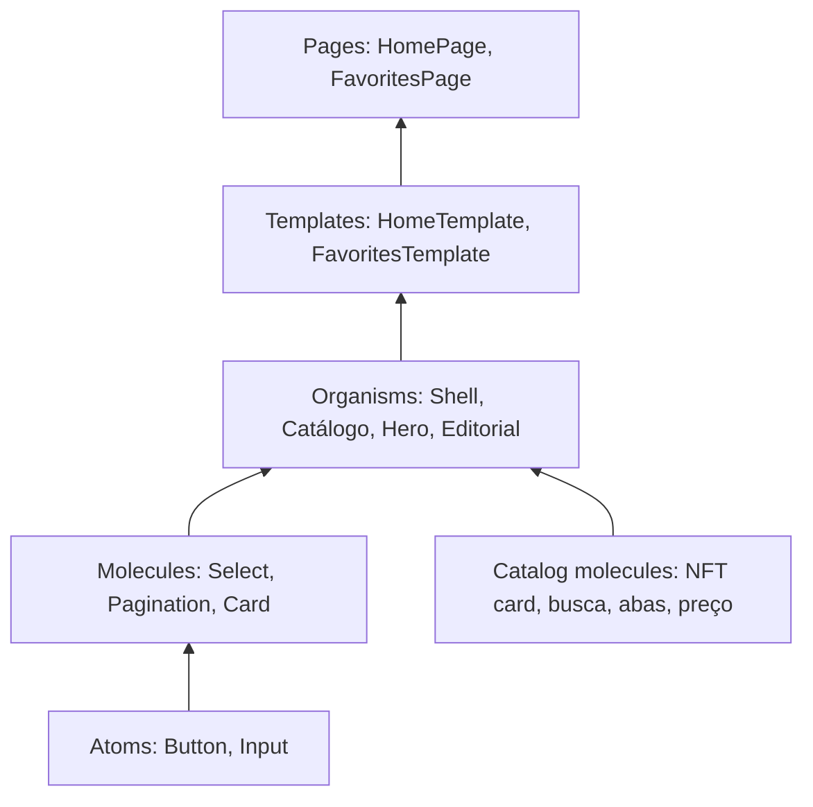

# Atomic Design e reutilização

Aplicamos Atomic Design com fronteiras de domínio: átomos e moléculas verdadeiramente genéricos vivem em `src/components`; componentes que conhecem NFTs ficam dentro de `src/features/catalog`; composições específicas de descoberta ficam em `src/features/home`. Isso preserva coesão e evita abstrações falsas.

## O que pertence a cada nível

### Atoms

Controles visuais básicos sem regra de negócio ou dependência de tela. Exemplos: `Button`, `Input` e o tema visual. São montados com props e tokens, nunca importam componentes de feature.

### Molecules

Unidades pequenas com propósito definido, compostas por átomos ou por HTML semântico. `Select` e `Pagination` são globais; `NftCard`, busca/ordenação, abas e faixa de preço pertencem ao domínio de catálogo. As moléculas de domínio podem conhecer o tipo `Nft`, mas não consultam endpoints nem conhecem qual página as compõe.

### Organisms

Seções completas com hierarquia própria: `CatalogSection`, `HeroCarousel`, `BlogSection` e `AppShell`. Recebem dados, estado e callbacks; evitam conter o ciclo de vida de uma página inteira.

### Templates

Definem o arranjo da página a partir de organismos. `HomeTemplate` e `FavoritesTemplate` são apresentações dirigidas por props: podem ser renderizados no Storybook com fixtures, sem iniciar Router ou chamadas REST.

### Pages

São entradas das rotas. Conectam Router, Query, persistência e serviços, transformando respostas em props para um template. Mantêm efeitos colaterais e decisões de carregamento fora da árvore visual.

## Regras para construir próximas telas

1. Procure primeiro o componente em `components/atoms`, `components/molecules` e nas moléculas de domínio antes de criar uma cópia.
2. Extraia um átomo global somente se ele não tiver vocabulário nem comportamento específico de uma feature.
3. Mantenha regras de catálogo dentro de `features/catalog`; outra tela pode reutilizar essas moléculas por import direto ou pelo barrel `features/catalog/molecules`.
4. Dê às moléculas controle explícito por props. O estado compartilhado da tela pertence ao template/page; estado transitório local pode ficar na molécula.
5. Crie uma story para cada componente visual novo, incluindo estados e variações relevantes. Organize o sidebar no mesmo nível: `Design System/Atoms`, `Design System/Molecules`, `<Feature>/Organisms`, `<Feature>/Templates`.
6. Componentes de página com integração externa recebem stories no template de apresentação, usando fixtures e callbacks falsos para que as stories sejam determinísticas.

## Mapa atual

| Nível | Local | Componentes |
| --- | --- | --- |
| Átomos globais | `src/components/atoms` | Button, Input, tema |
| Moléculas globais | `src/components/molecules` | Card, Select, Pagination |
| Moléculas de catálogo | `src/features/catalog/molecules` | NftCard, CatalogSearch, CatalogTabs, PriceRangeFilter |
| Organisms globais | `src/components/organisms` | AppShell |
| Organismos Home | `src/features/home/organisms` | HeroCarousel, CatalogSection/Filters/Results, FeaturedNft, Editorial, Blog, Promos, Newsletter |
| Templates | `src/features/{home,favorites}/templates` | HomeTemplate, FavoritesTemplate |
| Pages | `src/features/{home,favorites}/pages` | HomePage, FavoritesPage |

O Storybook é gerado por `*.stories.tsx` junto às camadas. A documentação visual é navegável por categoria, e as descrições de cada story explicam contratos, estados, teclado e acessibilidade pertinentes.
